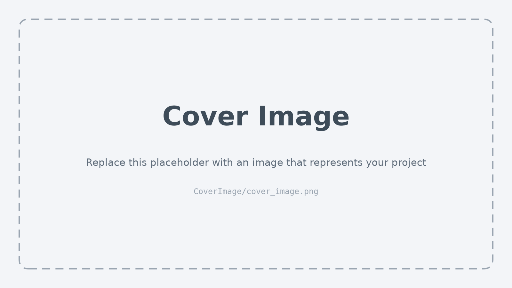

# Sales Forecasting for a Bakery Branch

## Description

This project focuses on sales forecasting for a bakery branch, utilizing historical sales data spanning from July 1, 2013, to July 31, 2018, to inform inventory and staffing decisions. We aim to predict future sales for six specific product categories: Bread, Rolls, Croissants, Confectionery, Cakes, and Seasonal Bread. Our methodology integrates statistical and machine learning techniques, beginning with a baseline linear regression model to identify fundamental trends, and progressing to a sophisticated neural network designed to discern more nuanced patterns and enhance forecast precision. The initiative encompasses data preparation, crafting bar charts with confidence intervals for visualization, and fine-tuning models to assess their performance on test data from August 1, 2018, to July 31, 2019, using the Mean Absolute Percentage Error (MAPE) metric for each product category.

### Task Type

Regression

### Results Summary

-   **Best Model:** [Name of the best-performing model]
-   **Evaluation Metric:** MAPE
-   **Result by Category** (Identifier):
    -   **Bread** (1): [XX]%
    -   **Rolls** (2): [XX]%
    -   **Croissant** (3): [XX]%
    -   **Confectionery** (4): [XX]%
    -   **Cake** (5): [XX]%
    -   **Seasonal Bread** (6): [XX]%

## Documentation

1.  [**Data Import and Preparation**](0_DataPreparation/)
2.  [**Dataset Characteristics (Barcharts)**](1_DatasetCharacteristics/)
3.  [**Baseline Model**](2_BaselineModel/)
4.  [**Model Definition and Evaluation**](3_Model/)
5.  [**Presentation**](4_Presentation/README.md)

## Data

The sales, weather and Kiel Week data are documented in the [course resources repository](https://github.com/opencampus-sh/intro-to-data-science-and-ml/blob/main/data/bakery/README.md). Load them directly from there, e.g.:

```python
import pandas as pd

BASE_URL = "https://raw.githubusercontent.com/opencampus-sh/intro-to-data-science-and-ml/main/data/bakery/"
sales = pd.read_csv(BASE_URL + "umsatzdaten_gekuerzt.csv")
```

[List here any additional data sources you use and the variables you created from them.]

## Setup

This repository uses [uv](https://docs.astral.sh/uv/). To reproduce the results, clone the repository and run `uv sync`; then select the Python interpreter from `.venv` as kernel for the notebooks. Add packages with `uv add <package>` so that `pyproject.toml` and `uv.lock` stay up to date for the whole team.


## Cover Image

[Replace `CoverImage/cover_image.png` with an image that represents your project.]


